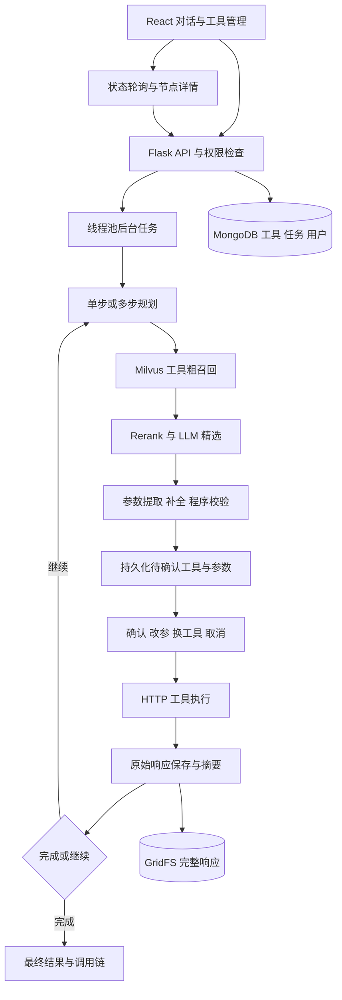

# Enterprise API Copilot

面向商品、供应商和订单等业务接口的自然语言操作助手。输入业务目标后，系统从工具目录选择接口、整理参数、补充依赖信息，并在主操作执行前展示待确认的工具与参数。执行过程以调用链呈现，支持查看节点详情和下载完整响应。

这是一个个人独立开发项目，围绕工具检索、任务编排、人工确认与执行可追溯性，探索如何把大模型接入已有业务系统。

[系统架构](docs/architecture.md) · [配置与运行](docs/setup.md) · [开发与验证](docs/development.md)

## 为什么做这个项目

业务系统通常已经有API，但跨接口操作仍需要理解接口名称、参数和数据关联。例如“查询某供应商的商品，再为指定商品创建订单”，需要先定位供应商、取得商品编号，再组织创建请求。仅让模型返回调用建议，既没有完成业务动作，也不便于检查参数依据。

本项目把这条链路拆成可观察的步骤：工具目录限定可选操作，检索缩小候选范围，模型负责语义选择和任务分解，程序负责参数约束、状态记录和HTTP执行，用户可以修改参数、切换工具或终止任务。

## 核心能力

| 能力 | 实际行为 | 代码入口 |
| --- | --- | --- |
| 账号与权限 | 注册、登录、JWT校验、进程内会话缓存及接口权限检查 | [app.py](backend/app.py) |
| 工具目录 | 解析OpenAPI JSON，保存工具、参数、调用地址并建立向量索引 | [ToolManager](backend/tools/tool_manager.py) |
| 多阶段工具选择 | Milvus粗召回、DashScope Rerank重排、LLM候选精选 | [ApiSelectionHub](backend/apis/api_selection_hub.py) |
| 参数提取与补全 | 根据工具定义提取参数，缺失时尝试通过查询工具取得依赖值 | [参数提取](backend/param_extraction/param_extraction_hub.py) |
| 程序校验 | 检查必填、类型、枚举、空值及字符串等约束 | [ParameterValidator](backend/param_extraction/parameter_validator.py) |
| 人工反馈 | 确认、终止、改参、换工具、澄清；改参后重新确认 | [规划器](backend/apis/api_planning_hub.py) |
| 多步续接 | 根据实际响应更新上下文，判断完成或规划下一步 | [GenerateTaskHub](backend/tasks/generate_task_hub.py) |
| 异步交互 | 线程池执行，HTTP立即返回任务编号，前端轮询状态 | [服务入口](backend/app.py) |
| 原始结果追溯 | 图节点关联执行记录，GridFS保存完整响应 | [结果存储](backend/tasks/tool_result_store.py) |
| 循环停止 | 步数预算、重复结果、连续同工具及短周期调用检测 | [循环控制](backend/apis/api_planning_hub.py) |

## 一次典型操作

以“为指定供应商的某商品创建订单”为例：

1. 导入业务系统的OpenAPI JSON，确认查询与创建接口都已进入目录。
2. 输入目标。系统判断单步或多步任务，选择当前应执行的接口。
3. 若创建接口缺少商品ID，尝试用查询工具取得；无法补齐则停止并说明原因。
4. 展示主操作和参数，允许确认、改数量、纠正工具或取消。
5. 确认后执行HTTP请求，保存实际参数、状态码和原始返回。
6. 根据返回继续下一步或结束，在页面查看调用链与节点详情。

补参阶段可能调用依赖接口。主操作确认与依赖查询是不同阶段，接入目录时需要检查补参工具的权限和副作用。

## 系统架构



Agent编排由Python规划器、持久化任务状态和反馈分支实现，当前执行引擎不依赖LangGraph或Redis队列。工具选择与反馈识别通过模型输出和后处理完成，不直接依赖模型厂商原生Function Calling协议。

## 技术栈

| 层次 | 技术 | 作用 |
| --- | --- | --- |
| 前端 | React、Ant Design、Ant Design X、Axios | 对话、账号、工具维护及确认交互 |
| 可视化 | relation-graph、节点详情组件 | 展示工具调用与执行结果 |
| 后端 | Flask、Flask-CORS、ThreadPoolExecutor | HTTP接口、权限与后台任务 |
| 业务存储 | MongoDB、MongoEngine | 工具定义、任务进度、节点及反馈日志 |
| 大响应 | GridFS | 保留完整正文，避免全部塞进任务文档与上下文 |
| 工具检索 | Milvus、Embedding、DashScope Rerank | 候选召回与精排 |
| 模型接入 | OpenAI兼容客户端、Prompt后处理 | 分解、选择、参数提取及摘要 |
| 参数约束 | 自定义校验器、Pydantic桥接 | 执行前程序检查 |

工具完整定义和向量说明分别维护，原始响应和派生摘要也分别保存。界面能下载完整数据，不代表模型在摘要阶段读取过全部原文。

## 目录

```text
backend/
  app.py                HTTP接口、鉴权和线程池
  apis/                 工具选择、规划和反馈处理
  entity/               用户、工具、参数和任务模型
  models/               聊天、Embedding和Rerank适配
  param_extraction/     参数提取、校验和桥接
  tasks/                子任务、状态和完整响应
  tools/                工具目录、HTTP执行和摘要
  prompt/               提示词与输出后处理
  utils/                配置、日志和常量
frontend/src/
  api/                  请求封装和认证拦截
  pages/Coplilot/        对话、调用链和节点详情
  pages/Graph/           图形展示
docs/                   架构、配置和开发说明
```

## 快速开始

准备Python 3.11、Node.js、MongoDB和Milvus，以及聊天、`text-embedding-v3`和Rerank服务账号。业务操作需要自己的测试API与OpenAPI目录。

```bash
git clone https://github.com/amazingLH/enterprise-api-copilot.git
cd enterprise-api-copilot/backend
python -m venv .venv
# Windows：.venv\Scripts\activate
# Linux/macOS：source .venv/bin/activate
python -m pip install -r requirements.txt
```

复制`.env.example`为`.env`并填写配置，在`backend`执行`python app.py`，后端监听`http://127.0.0.1:5001`。另开终端：

```bash
cd frontend
npm ci
npm start
```

前端默认使用`http://localhost:5001`。地址覆盖、工具导入格式、管理权限及模型配置见[配置与运行](docs/setup.md)。

## 开发验证记录

| 检查项 | 记录结果 | 范围 |
| --- | --- | --- |
| 工具选择F1 | 0.9905 | 21个工具、37个任务用例 |
| 必填参数完整率 | 100% | 同组用例的必填参数检查 |
| 参数类型正确率 | 100% | 同组用例的类型检查 |
| 预期停止行为 | 8/8通过 | 有预期停止原因的8个用例 |

以上为已有开发记录，统计范围是对应样例与配置。指标含义、功能检查步骤及扩展方法见[开发与验证](docs/development.md)。

## 后续改进

- 增加确认原子认领、执行幂等键和任务owner检查。
- 用显式元数据代替操作名称风险推断，限制补参工具的副作用。
- 完善OpenAPI兼容性、外部调用超时、故障恢复及版本化回归数据。

## 文档导航

| 文档 | 内容 |
| --- | --- |
| [系统架构](docs/architecture.md) | 模块、状态、检索、参数、反馈、原始结果与执行边界 |
| [配置与运行](docs/setup.md) | 环境变量、服务依赖、模型、导入与启动排查 |
| [开发与验证](docs/development.md) | 接口契约、代码阅读顺序、验证矩阵与指标口径 |
